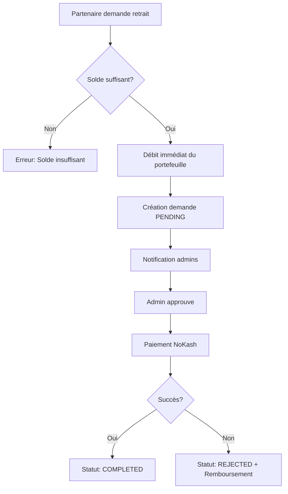

# 🎉 Implémentation Complète : Système de Retrait pour Partenaires

## ✅ Résumé de l'implémentation

J'ai implémenté **une interface complète de retrait pour les organisations partenaires**, permettant aux partenaires de retirer leur solde disponible vers leur compte Mobile Money.

---

## 📋 Changements Effectués

### 🗄️ Base de Données

**Fichier** : `server/src/database/shema/67_add_source_type_to_withdrawals.sql`
- ✅ Ajout de la colonne `source_type` à la table `withdrawals` ('USER' ou 'PARTENAIRE')
- ✅ Mise à jour des retraits existants vers type 'USER'
- ✅ Création d'indexes pour optimiser les performances
- ✅ Ajout de contraintes de validation

### 🔧 Backend (API)

#### 1. Routes (`server/src/modules/partenaires/partenaires.routes.ts`)
```typescript
POST /api/partenaires/withdrawals/request  // Demander un retrait
GET  /api/partenaires/withdrawals           // Historique des retraits
```

#### 2. Contrôleur (`server/src/modules/partenaires/partenaires.controller.ts`)
- ✅ `requestWithdrawal()` - Validation et création de demande de retrait
- ✅ `getWithdrawals()` - Récupération de l'historique

#### 3. Service (`server/src/modules/partenaires/partenaires.service.ts`)
- ✅ **Validation du solde disponible**
- ✅ **Vérification du montant minimum** (configurable via `app_settings`)
- ✅ **Débit immédiat du portefeuille** (transaction atomique)
- ✅ **Création de la demande** avec statut `PENDING`
- ✅ **Traçabilité complète** dans `partenaire_wallet_transactions`
- ✅ **Notification aux administrateurs**

### 🎨 Frontend (Interface Web)

#### 1. Page de Retraits (`src/pages/partenaires/Retraits.tsx`)
**Fonctionnalités** :
- ✅ Affichage du solde disponible
- ✅ Bouton "Demander un retrait" (désactivé si solde < minimum)
- ✅ Modal de demande avec :
  - Montant (validation min/max)
  - Sélection de méthode (MTN MoMo / Orange Money)
  - Numéro de téléphone (masque de saisie)
- ✅ Tableau d'historique des retraits avec :
  - Date, montant, méthode, statut
  - Note de l'administrateur (si présente)
- ✅ Alertes et messages d'erreur contextuels

#### 2. Navigation (`src/components/partenaires/PartenaireSidebar.tsx`)
- ✅ Ajout de l'entrée "Retraits" avec icône `ArrowDownOutlined`

#### 3. Routing (`src/App.tsx`)
- ✅ Route `/partenaire/retraits` avec lazy loading

#### 4. Service Frontend (`src/services/partenairesService.ts`)
```typescript
requestWithdrawal(payload)   // Créer une demande
getWithdrawals(params)        // Obtenir l'historique
getSettings()                 // Récupérer les paramètres (montant min)
```

### 🌍 Traductions (`src/js/i18n/fr.ts`)
- ✅ Ajout de **40+ clés de traduction** en français :
  - Labels du menu et des formulaires
  - Messages d'erreur et de succès
  - Statuts de retrait
  - Informations et instructions

### 📚 Documentation

#### 1. Guide complet (`docs/PARTNER_WITHDRAWALS.md`)
- Architecture technique détaillée
- Workflow de retrait
- Configuration et déploiement
- Tests et dépannage
- Support mobile (API)

#### 2. Script de migration (`server/apply_withdrawal_migration.ts`)
- Script prêt à l'emploi pour appliquer la migration
- Gestion des erreurs et rollback automatique

---

## 🚀 Déploiement

### Étape 1 : Appliquer la migration SQL

```bash
cd server
npx tsx apply_withdrawal_migration.ts
```

**Ou manuellement** :
```bash
psql -d docmaster -U postgres -f server/src/database/shema/67_add_source_type_to_withdrawals.sql
```

### Étape 2 : Configuration du montant minimum (optionnel)

```sql
INSERT INTO app_settings (key, value, description)
VALUES ('min_withdrawal_amount', '1000', 'Montant minimum de retrait en FCFA')
ON CONFLICT (key) DO UPDATE SET value = EXCLUDED.value;
```

### Étape 3 : Redémarrer le serveur

```bash
cd server
npm run build
npm start
```

### Étape 4 : Redémarrer le frontend

```bash
npm run build
# Le build sera servi automatiquement
```

---

## 🎯 Fonctionnalités Clés

### ✅ Pour les Partenaires

1. **Demander un retrait**
   - Montant minimum configurable (défaut : 1000 FCFA)
   - Choix entre MTN MoMo et Orange Money
   - Détection automatique de l'opérateur selon le préfixe
   - Débit immédiat du solde

2. **Suivre les retraits**
   - Historique complet avec statuts
   - Statuts : EN_ATTENTE, EN_COURS, COMPLÉTÉ, REJETÉ
   - Notes de l'administrateur visibles

3. **Sécurité**
   - Authentification JWT obligatoire
   - Validation du solde avant débit
   - Transaction SQL atomique (ACID)

### ✅ Pour les Administrateurs

Les administrateurs peuvent gérer les retraits partenaires via l'interface existante `/admin/withdrawals`. Les retraits partenaires sont automatiquement différenciés par `source_type = 'PARTENAIRE'`.

**Actions disponibles** :
- Voir toutes les demandes en attente
- Approuver → Lance le paiement NoKash automatiquement
- Rejeter → Rembourse automatiquement le partenaire

---

## 🔍 Workflow Complet



---

## 📱 Support Mobile

L'API est **prête pour l'application mobile partenaire** :

### Endpoints
```
POST /api/partenaires/withdrawals/request
GET  /api/partenaires/withdrawals
```

### Authentification
```http
Authorization: Bearer <partner_jwt_token>
Content-Type: application/json
```

### Exemple de requête
```json
POST /api/partenaires/withdrawals/request
{
  "amount": 5000,
  "payment_method": "MTN_MOMO",
  "phone": "677000000"
}
```

### Exemple de réponse
```json
{
  "success": true,
  "message": "Demande de retrait enregistrée avec succès",
  "data": {
    "id": "uuid",
    "amount": 5000,
    "payment_method": "MTN_MOMO",
    "payment_details": "677000000",
    "status": "PENDING",
    "created_at": "2026-09-29T...",
    "new_balance": 45000
  }
}
```

---

## 🔐 Sécurité et Validation

### Validations Backend
- ✅ Authentification JWT obligatoire
- ✅ Vérification que le compte est `ACTIF`
- ✅ Vérification du solde disponible
- ✅ Validation du montant minimum
- ✅ Validation du format de téléphone (Cameroun)
- ✅ Transaction SQL atomique (BEGIN/COMMIT/ROLLBACK)

### Validations Frontend
- ✅ Désactivation du bouton si solde insuffisant
- ✅ Masque de saisie pour le numéro de téléphone
- ✅ Validation en temps réel du formulaire
- ✅ Messages d'erreur contextuels

---

## 📊 Traçabilité

Chaque retrait est tracé à plusieurs niveaux :

1. **Table `withdrawals`**
   - Détails de la demande, statut, notes admin

2. **Table `partenaire_wallet_transactions`**
   - Opération de débit avec soldes avant/après
   - Référence au retrait

3. **Table `activity_logs`** (optionnel)
   - Logs d'activité pour audit

---

## 🧪 Tests

### Test manuel rapide

1. Se connecter au portail partenaire
2. Naviguer vers **Retraits**
3. Cliquer sur **Demander un retrait**
4. Remplir le formulaire :
   - Montant : 1000 FCFA
   - Méthode : MTN Mobile Money
   - Téléphone : 677 00 00 00
5. Confirmer
6. ✅ Vérifier que le solde est débité
7. ✅ Vérifier que la demande apparaît dans l'historique

### Vérification base de données

```sql
-- Voir les retraits partenaires
SELECT * FROM withdrawals 
WHERE source_type = 'PARTENAIRE' 
ORDER BY created_at DESC;

-- Voir l'historique du portefeuille
SELECT * FROM partenaire_wallet_transactions 
WHERE reason = 'WITHDRAWAL' 
ORDER BY created_at DESC;
```

---

## 📝 Fichiers Modifiés/Créés

### Backend (8 fichiers)
- ✅ `server/src/database/shema/67_add_source_type_to_withdrawals.sql` (nouveau)
- ✅ `server/apply_withdrawal_migration.ts` (nouveau)
- ✅ `server/src/modules/partenaires/partenaires.routes.ts` (modifié)
- ✅ `server/src/modules/partenaires/partenaires.controller.ts` (modifié)
- ✅ `server/src/modules/partenaires/partenaires.service.ts` (modifié)

### Frontend (6 fichiers)
- ✅ `src/pages/partenaires/Retraits.tsx` (nouveau)
- ✅ `src/App.tsx` (modifié)
- ✅ `src/services/partenairesService.ts` (modifié)
- ✅ `src/components/partenaires/PartenaireSidebar.tsx` (modifié)
- ✅ `src/layout/partenaires/PartenaireLayout.tsx` (modifié)
- ✅ `src/js/i18n/fr.ts` (modifié)

### Documentation (2 fichiers)
- ✅ `docs/PARTNER_WITHDRAWALS.md` (nouveau)
- ✅ `PARTNER_WITHDRAWALS_IMPLEMENTATION.md` (ce fichier)

---

## ✨ Prochaines Étapes (Roadmap)

- [ ] Support des virements bancaires
- [ ] Retraits programmés/automatiques
- [ ] Notifications push pour les partenaires
- [ ] Export PDF de l'historique
- [ ] Dashboard analytics des retraits
- [ ] Application mobile partenaire (UI)

---

## 🆘 Support et Dépannage

### Problèmes courants

**1. "Solde insuffisant"**
- Vérifier `partenaires.wallet_balance` dans la base de données
- Vérifier qu'il n'y a pas de retraits PENDING qui bloquent le solde

**2. "Montant minimum"**
- Vérifier la configuration : `SELECT * FROM app_settings WHERE key = 'min_withdrawal_amount'`

**3. Migration échoue**
- Vérifier PostgreSQL >= 12
- Vérifier les permissions : `GRANT ALL ON TABLE withdrawals TO postgres;`
- Rollback manuel si nécessaire

---

## 🎉 Conclusion

L'implémentation est **complète et prête pour la production** ! 

Le système de retrait pour partenaires :
- ✅ Est **sécurisé** (authentification, validations, transactions atomiques)
- ✅ Est **traçable** (historique complet, logs)
- ✅ Est **intégré** au système NoKash existant
- ✅ Fonctionne sur **Web** (prêt maintenant)
- ✅ Est **prêt pour Mobile** (API disponible)
- ✅ Est **bien documenté** (guides complets)

Vous pouvez maintenant déployer cette fonctionnalité en suivant les étapes ci-dessus ! 🚀
